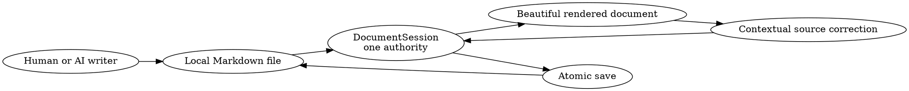

# SimpleMark 1.0 Launch Document Implementation Plan

> **For agentic workers:** REQUIRED SUB-SKILL: Use superpowers:subagent-driven-development (recommended) or superpowers:executing-plans to implement this plan task-by-task. Steps use checkbox (`- [ ]`) syntax for tracking.

**Goal:** Build a second public-quality Markdown showcase that functions as a candid, evidence-linked SimpleMark 1.0 founder and launch-team plan while demonstrating serious everyday product work in the current renderer.

**Architecture:** One portable Markdown document carries the launch narrative. Every consequential assertion is visibly classified as current evidence, a 1.0 gate, a future target, or an accepted decision. A repository-level Vitest contract checks structure, local evidence links, status language, and unsupported capabilities; a Playwright test opens the exact document content and proves its current renderers without creating a second GIF.

**Tech Stack:** Markdown, Graphviz/DOT, JSON, ANSI/diff/tree text cards, TypeScript 5.9, Vitest, Playwright, current SimpleMark browser shell.

## Global Constraints

- Follow the accepted design in [`2026-08-08-simplemark-showcase-design.md`](../specs/2026-08-08-simplemark-showcase-design.md).
- Before Task 1, create and claim a separate implementation task on the live `simplemark` Switchboard board; `APP-29` remains the design-and-plan provenance task.
- This is an aspirational 1.0 plan, not a claim that 1.0 has shipped.
- Start current-truth research from [`PRODUCT.md`](../../PRODUCT.md), [`README.md`](../../../README.md), [`RENDERERS.md`](../../RENDERERS.md), [`RELEASE-CONTRACT.md`](../../RELEASE-CONTRACT.md), accepted ADRs, current composition roots, package scripts, and executable tests. Stale prose does not outrank current code.
- Mark every consequential statement with exactly one kind: **Current evidence**, **1.0 gate**, **Target**, or **Decision**.
- A **Current evidence** claim must link to a current repository file, test, executable script, or real verified artifact. If it cannot, demote it to a gate or remove it.
- A **Target** must state a future measurement window and owner; it cannot read like a present result.
- Use only current renderers. Do not mention or use Markmap, and do not add product code or document-specific CSS.
- Keep the visual personality precise and editorial: warm paper, graphite structure, green for evidence, amber for unresolved launch risk. Do not reuse Project Tanoa's lagoon/place motifs.
- Do not create a launch-plan GIF in this phase.
- Do not invent customers, adoption, testimonials, revenue, performance, store approval, signing, notarization, or release provenance.
- The document may cite the Project Tanoa artifact as flagship proof only after the exact artifact exists and passes its checks; until then it is a 1.0 gate.

## File Map

| Path | Action | Responsibility |
|---|---|---|
| `docs/showcase/simplemark-1.0-launch-plan.md` | Create | Finished founder/launch-team brief |
| `tests/app/simplemark-launch-showcase.test.ts` | Create | Structure, evidence, truth-kind, links, and capability contract |
| `tests/ui/simplemark-launch-showcase.spec.ts` | Create | Exact-document visual renderer and fidelity proof |

---

### Task 1: Build the evidence ledger before writing launch prose

**Files:**
- Create: `tests/app/simplemark-launch-showcase.test.ts`
- Create: `docs/showcase/simplemark-1.0-launch-plan.md` as a deliberately incomplete skeleton

**Interfaces:**
- The document uses blockquote labels in the exact forms `> **Current evidence**`, `> **1.0 gate**`, `> **Target**`, and `> **Decision**`.
- Every local evidence link is relative to `docs/showcase/` and must resolve in the checkout.

- [ ] **Step 1: Inspect current implementation truth and record only reproducible facts**

Read these exact surfaces and capture the claim each can support:

| Source | Permitted current-evidence claim |
|---|---|
| `docs/PRODUCT.md` | Current job, boundary, sequencing, and product language |
| `docs/decisions/0005-rendered-document-before-agent-participation.md` | Rendered-document-first decision |
| `docs/decisions/0006-one-authoritative-change-stream.md` | External-writer/provenance boundary, only to the extent accepted architecture states it |
| `src/app/browser.ts`, `src/app/tauri.ts` | Renderers and shell capabilities actually composed today |
| `src/application/document-session.ts` and its tests | Current document authority and save behavior |
| `scripts/simplemark_ci.sh` | Current local/CI gate, without implying a run has passed |
| `scripts/collect-platform-smoke.mjs` and tests | Evidence shape and refusal rules, without implying release trust is complete |
| `src-tauri/tauri.conf.json`, `package.json` | Current product/version/build declarations, not store readiness |

Do not turn a planned ADR path into shipped behavior. Where source inspection is insufficient, phrase the item as a 1.0 gate.

- [ ] **Step 2: Write the failing structural contract**

Create `tests/app/simplemark-launch-showcase.test.ts`:

```ts
import { existsSync, readFileSync } from 'node:fs'
import { dirname, resolve } from 'node:path'
import { describe, expect, it } from 'vitest'

const path = resolve('docs/showcase/simplemark-1.0-launch-plan.md')
const source = readFileSync(path, 'utf8')
const headings = [...source.matchAll(/^## (.+)$/gm)].map((match) => match[1])

describe('SimpleMark 1.0 launch showcase', () => {
  it('carries the complete launch decision sequence', () => {
    expect(headings).toEqual([
      'Launch decision',
      'Current truth and the 1.0 bar',
      'The defining experience',
      'Category and positioning',
      'Product and release architecture',
      'Launch readiness',
      'Success measures',
      'Risks and decisions',
      'Six-week launch sequence',
      'Release proof',
      'Launch language',
      'Evidence notes',
    ])
  })

  it('uses every truth kind and no unsupported renderer', () => {
    for (const kind of ['Current evidence', '1.0 gate', 'Target', 'Decision']) {
      expect(source).toContain(`> **${kind}**`)
    }
    expect(source).not.toMatch(/markmap/i)
  })

  it('keeps local evidence links live', () => {
    const links = [...source.matchAll(/\[[^\]]+\]\(([^)]+)\)/g)].map((match) => match[1] ?? '')
    for (const link of links.filter((link) => !/^[a-z]+:/i.test(link) && !link.startsWith('#'))) {
      expect(existsSync(resolve(dirname(path), link.split('#')[0] ?? '')), link).toBe(true)
    }
  })
})
```

- [ ] **Step 3: Run the test and confirm the document is incomplete**

Run: `npx vitest run tests/app/simplemark-launch-showcase.test.ts`

Expected: FAIL because the document is missing or its headings/content are incomplete.

- [ ] **Step 4: Create the exact heading skeleton and evidence-note convention**

Start with:

```md
# SimpleMark 1.0
*Launch plan for the beautiful living document for AI work*

> [!IMPORTANT]
> **Planning document — not a shipped-product claim.** Current evidence is linked; gates and targets describe future conditions.
```

Add the twelve level-two headings in the test. Under `Evidence notes`, define all four kinds in plain language and state the evidence snapshot date and commit under review.

- [ ] **Step 5: Add truth-language regression checks**

Fail the test when:

- `1.0 is available`, `has launched`, `customers`, `revenue`, or an unlabeled percentage appears;
- `Current evidence` is followed by no Markdown link within the same blockquote;
- a `Target` lacks `Owner:` or `Window:`;
- a `1.0 gate` lacks `Exit evidence:`;
- a risk row lacks owner, state, exit evidence, and decision date;
- the file mentions a second GIF.

Use narrow parsing around labelled blocks/tables. Do not write a broad prose linter that governs unrelated docs.

- [ ] **Step 6: Commit the truth skeleton and contract**

```bash
git add docs/showcase/simplemark-1.0-launch-plan.md tests/app/simplemark-launch-showcase.test.ts
git commit -m "docs: frame the SimpleMark 1.0 launch brief"
```

---

### Task 2: Author the polished founder and launch-team brief

**Files:**
- Modify: `docs/showcase/simplemark-1.0-launch-plan.md`
- Modify: `tests/app/simplemark-launch-showcase.test.ts`

**Interfaces:**
- Consumes the evidence ledger from Task 1.
- Produces one readable decision document, not a renderer catalogue or status dashboard.

- [ ] **Step 1: Write the launch decision and defining experience**

Lead with the decision under review, intended user, product promise, and the four-step defining experience:

1. open an agent-written local Markdown file;
2. read it as a beautiful rendered document;
3. see an external change reported honestly;
4. reveal and correct one exact source block.

Classify the promise as a **Decision** and each unproven distribution/reliability condition as a **1.0 gate**.

- [ ] **Step 2: Separate current truth from the 1.0 bar**

Use a five-column table:

| Surface | Current evidence | 1.0 gate | Owner | Exit evidence |
|---|---|---|---|---|

Cover rendered Markdown, technical renderers, fidelity, native file opening, external changes, macOS build, cross-platform artifacts, release trust, accessibility, website/download path, support, and cultural review for the flagship. Link every current-evidence cell. Leave people as role owners (`Founder`, `Product`, `Engineering`, `Release`) unless real names have been supplied.

- [ ] **Step 3: Write positioning with explicit refusals**

State the category as a beautiful living document for AI-generated Markdown. Contrast only with jobs, not named competitors. Preserve the boundary: no broad AI workspace, agent cockpit, chat-first surface, cloud document authority, or proprietary file format.

- [ ] **Step 4: Add the DOT architecture as decision evidence**

Use one `dot` fence with this conceptual path:



In prose, say that a watcher reports a change; do not claim author attribution, automatic merge, or shipped realtime collaboration.

- [ ] **Step 5: Write readiness, measures, and risk decisions**

Use:

- a launch-readiness table with `Proven`, `At risk`, `Blocked`, and `Not started` states tied to evidence;
- future targets for first-file success, time to first rendered document, crash-free sessions, byte-fidelity regressions, renderer error rate, and download-to-open conversion;
- no fabricated baseline values;
- a risk register for fidelity, renderer failure, platform trust, stale marketing claims, accessibility, external-change expectations, and showcase cultural review.

Each future metric must name `Owner:` and `Window:`. Prefer guardrails such as zero known byte-loss regressions over invented adoption figures.

- [ ] **Step 6: Write the six-week sequence in ordinary Markdown**

Use six level-three week headings, checklists, owners, and dependencies. Do not simulate a roadmap renderer. The sequence must end in evidence collection and a go/no-go decision, not an automatic launch.

- [ ] **Step 7: Add only real release proof**

Include ordinary highlighted shell commands for the current canonical checks, a `tree` fence for the intended public artifact shape, and a short `ansi` or `diff` card only if its contents are copied from a real run/patch performed during implementation. Label command examples that have not been executed as commands to run, never terminal evidence.

- [ ] **Step 8: Finish launch language and evidence notes**

Provide a headline, short description, announcement draft, and a `Language to avoid` table. Keep “beautiful living document for AI work” aligned with current product language. Link the exact repository sources used and state the evidence snapshot commit/date.

- [ ] **Step 9: Run the document contract and plain-Markdown review**

Run: `npx vitest run tests/app/simplemark-launch-showcase.test.ts`

Run: `git diff --check`

Expected: PASS. Read the raw Markdown from top to bottom and confirm the launch decision remains useful without any custom renderer.

- [ ] **Step 10: Commit the finished launch document**

```bash
git add docs/showcase/simplemark-1.0-launch-plan.md tests/app/simplemark-launch-showcase.test.ts
git commit -m "docs: author the SimpleMark 1.0 launch plan"
```

---

### Task 3: Prove the exact launch document in SimpleMark

**Files:**
- Create: `tests/ui/simplemark-launch-showcase.spec.ts`

**Interfaces:**
- Opens the exact repository document through the browser file port.
- Proves the current DOT/text-card/code/table/callout rendering and untouched-byte save.
- Does not add a recorder or second GIF.

- [ ] **Step 1: Open the exact document bytes in the file-port harness**

Read `docs/showcase/simplemark-1.0-launch-plan.md` at test-module load, seed the OPFS file in `showOpenFilePicker`, open through the visible control, and wait for filename `simplemark-1.0-launch-plan`.

- [ ] **Step 2: Assert the editorial reading surface and renderer evidence**

Assert the title and planning caveat are visible; all four truth kinds appear; the DOT block renders an SVG containing `DocumentSession`; the readiness and risk tables are visible; the week checklists render; expected code/text cards are present; and `.diagram-error:visible` has count zero.

Use accessible names and renderer labels wherever available. Avoid screenshot goldens that would bind the artifact to one font rasteriser.

- [ ] **Step 3: Prove untouched-byte save**

Click Save without editing, read the OPFS-backed file, and compare it byte-for-byte with the repository document. This protects the showcase's portability claim rather than merely testing the visual surface.

- [ ] **Step 4: Run the focused UI proof**

Run: `npx playwright test tests/ui/simplemark-launch-showcase.spec.ts`

Expected: PASS with no renderer error and exact bytes preserved.

- [ ] **Step 5: Run the complete two-document document checks**

After Project Tanoa exists, run:

```bash
npx vitest run tests/app/project-tanoa-showcase.test.ts tests/app/simplemark-launch-showcase.test.ts
npx playwright test tests/ui/project-tanoa-showcase.spec.ts tests/ui/simplemark-launch-showcase.spec.ts
git diff --check
```

If Project Tanoa has not yet been implemented, run only the SimpleMark launch tests and keep any link to that flagship classified as a 1.0 gate.

- [ ] **Step 6: Visually inspect the exact file in the latest app**

Open the file in the current browser and native shells. Inspect the opening, current-vs-1.0 table, DOT architecture, readiness table, risk register, six-week sequence, release proof, and final launch copy. Confirm it feels like one polished operating brief rather than a collection of samples.

- [ ] **Step 7: Commit the UI proof**

```bash
git add tests/ui/simplemark-launch-showcase.spec.ts
git commit -m "test: prove the SimpleMark launch showcase"
```

---

## Final Acceptance

- [ ] The document is candid enough for the founder and launch team and polished enough to show publicly.
- [ ] Every consequential statement is visibly a current fact, 1.0 gate, future target, or decision.
- [ ] Every current fact links to evidence available in the checkout or a real verified artifact.
- [ ] No aspirational work reads as shipped, and no adoption or release metric is invented.
- [ ] The exact Markdown renders with no error card and saves untouched bytes exactly.
- [ ] The architecture, readiness, metrics, risks, roadmap, and launch copy form one coherent decision narrative.
- [ ] The document uses no Markmap, no product-specific styling, no new renderer, and no second GIF.
